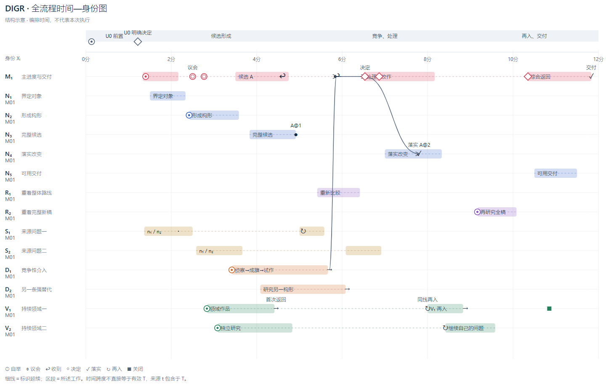

# DIGR 时间—工作标识图

这是默认 RETURN 的渲染说明与细读入口。它扩展现有过程标题、阶段符号与最终事实报告，不改变参数责任、执行授权或计时。图中不记录隐藏思维链，也不是任务完成认证器。



上图使用明确标为 `illustration` 的构造数据；时间、工作标识数量与决定均不是本轮实录，也不是固定必经次序。可编辑原件：[SVG](examples/visual-return/pipeline.svg)；同源数据：[pipeline.json](examples/visual-return/pipeline.json)。

## 返回怎样组织

1. 先给成品、当前入口与最重要结果。
2. 放一张可保存的时间总图，明确是实录、结构示意还是部分记录。
3. 直接写出少量重要后果与未落实事项，不能要求先选择事件才知道结果。比如“收到何物 → 怎样决定 → 哪个版本真的改变”，有据未采纳也可以是完整介入的结果。
4. 互动细读作为可选入口，查看具体事件、工作区段、执行者、所读版本与关系。原有参数、来源、时钟与范围事实仍保留；不能用好看的图替代。

图只呈现明确提供的公开工作摘要。现有session活动钟没有记录每个N/R与全部交流；因此本工具不从计数、文件mtime或代理结束状态反推一份完整历史。

## 坐标与有类型的标识

横轴是时间，向右推进。实录模式使用带时区起点及同一可比域的时间偏移；示意模式明确说明时间是编排。区间跨度、身份延续、墙钟和有效T/t分别保留，不能相互换算。

纵轴每行一个 `X_i`，多主时用完整作用域，例如 `M01.N01` 与 `M02.N01`。不同类别标识的对象并不相同：

| 类别 | 行表达什么 | 避免的误读 |
|---|---|---|
| M_i | 完整独立主进度；其自身工作与交付 | 不是把其它M的责任合成一个总数 |
| N_i | Main自身的一项实质推进 | 不是新生的一名代理，也不是每个命令 |
| R_i | 带新问题对完整候选的整体重开 | 新工作在未来发生，不画执行时间倒流 |
| S_i | 一个真实来源问题/工作面；内含n/r推进 | URL数、文章数不等于S数 |
| D_i | 竞争性介入，含独立研究与Main处理 | 返回不自动表示已采用或落实；不采纳不自动算失败 |
| V_i | 一条持续领域，多次研究与再入 | 同一V不必同一执行者，也不代表已读当前候选 |

T/t是时间事实，B/b是策略，L是隔离模式，放在说明/事实区；不给它们虚构人物泳道。图的标识、实际执行者、工作区段与候选版本分开：V01/研究者δ/一次活动/A@1是四种信息。

## 动作图形与阶段注记

| 图形 | 含义 | 注记内容 |
|---|---|---|
| 细虚线 | 同一工作标识的延续 | 不是持续在线、持续执行或有效计时 |
| 色区段 | 输入提供的工作窗 | 问题/方法、执行者、所读对象与来源位置 |
| ⊙ | 自举或进入工作状态 | 本阶段的问题、材料/方法、责任与记录边界；不等于重启协议 |
| ◎ | 议会与材料交流 | 参与者/材料/分歧和形成的领域；可分批、多次发生，不是同步栅栏 |
| → / ↩ | 发出 / 收到 | 两个独立事实，可以存在间隔或时间未知 |
| ◇ | 有依据的决定 | 采用、拒绝、保留、继续研究及其对象 |
| ✓ | 已实际落实的改变 | 新作品/文件/候选版本；不是仅作出采用决定 |
| ↻ | 同线再入/重研 | 同一个标识、新问题与所针对的版本 |
| ■ / Ⅱ | 线路关闭 / 暂停 | 只有实际发生才标；首次返回不是关闭 |

U0放在独立前置区，保留原话、研究后的解释、问答与明确决定，和正式投入分开。它不是N01。正式Main、D侦察成旗、V探索分域、N/R/S问题形成或再入，可分别带自举标记；不新增“一律必须走完”的检查门槛。具体说明仍以本轮取得的pinned协议为准。

交流的实线只连接明确记录的消息/处理/落实。材料引用与相关性使用无方向虚线并有文字说明，不冒充执行因果。点击或选择一项返回，显示其已记录的因果链及邻接材料；没有边就不凭时间相邻补边。[Perfetto的tracks/slices/flows区分](https://perfetto.dev/docs/getting-started/converting)提供了构形参考；这里采用的是设计判断，并未引入Perfetto运行时。[Mermaid的participant、activation与notes](https://mermaid.js.org/syntax/sequenceDiagram)同样提示应分开主体/活动/注记，不能把所有行画成人物。

## 密集图与多主

单M小图可全展开。M>1时，互动入口以M作为一级作用域，明确显示折叠范围、各类标识覆盖、本线提供的配置及未处理后果。输入未给配置时写“未提供”，不能从行数猜目标/实际。选中子事件会展开其真实作用域和已记录关系端点；不会把隐藏端点吸到M头部。打印与SVG保留全展开。

窄屏不把固定宽图缩到字不可读：按实际容器重新布置时间坐标。毫秒/秒/分钟随实际跨度共同切换，静态图与互动轴一致；无时间不造0轴。

每行标题都是原生按钮，可以用触控或键盘打开本行全部行为/区段；图上按同一行的实际点按邻域列出候选，明确选择后才打开详情，遮挡不替用户决定。未定位条目也在完整选择入口。详情用正常字号分别显示该条的时间、执行者、对象版本、依据与说明，直接关系按钮可继续查看前后事实；材料引用/相关明确无执行因果。全图与跨行关系始终保留，细读放在图后，另有“返回图中”恢复对应行焦点。代价是详情离下方或上方工作行仍有距离，未做真实读者实验。

展示偏好由实际数据指纹约束；旧候选的选择不能静默套到新版，同一次状态回声不重建邻域。它只保存选中项/折叠范围，不把状态转成用户调用或确认。鼠标、320/736窄屏与键盘的实际浏览器检查覆盖核心路径，不宣称全客户端或无障碍合规认证。

## 缺时与记录边界

- 时刻缺失或不属于主轴可比域：不定位到0，不按编号等距排成伪时间图。身份与事实仍保留在文字出口。
- 只知开始/结束：只画已知端点，不把未知尾段延长至“现在”。无可定位时间时直接写“时间未定位”。
- 已知消息关系的端点不可定位：保留关系文字，不计算延迟。SVG也附未定位事实清单。
- 同一本地时钟域即便不能映到主轴，内部先后仍需一致；因果传播经未知节点也不能接受已知的逆序。引用/相关不参与这项因果推导。
- `source_ref`只是操作者提供的依据位置，工具不认证其真实性、语义或完成质量；实录也不是可信签名。

## 复用入口

Python3.10+，渲染工具只用标准库，不调用模型、服务器或浏览器。截图与交互检查另使用本机浏览器；不是运行本工具的必要条件。

```text
python -B tools/codex.py timeline --input codex/examples/visual-return/pipeline.json --out D:/task/pipeline.svg
python -B tools/codex.py timeline --input D:/task/facts.json --out D:/task/pipeline-dark.svg --theme dark
python -B tools/codex.py timeline --input D:/task/facts.json --out D:/task/pipeline.html --format fragment
```

最后一项是会话可视化片段，不是一个新网站。宿主支持时可作细读入口；静态图和关键事实仍能独立承担最终返回。

输入见 [构造样例](examples/visual-return/pipeline.json)、[多主反例](examples/visual-return/multi-main.json)、[缺失时间反例](examples/visual-return/unknown-time.json)。最小字段为schema_version、mode、title、axis_domain、tracks、events、links。实录另需带时区origin，每个活动/事件需source_ref。工作标识保留M作用域；区段可有start/end=null。artifact_versions/references/unhandled是字符串列表，executor是字符串。M行可声明configuration与unhandled；缺省不会被解释成没有责任或后果。highlights是操作者明确选择的默认事实，不由工具猜测；多M时按它引用的事件显示作用域。

### 哪些已落地

已实现同源SVG/会话片段、六类工作标识、各动作、因果细读、区段元数据、M作用域展开、缺时出口和声明边界；已有真实浏览器与行为测试。没有自动采集所有会话消息、恢复隐藏推导、自动认证N/R/D/V或证明理解改善。没有改动stable或新增阶段执行闸门。
