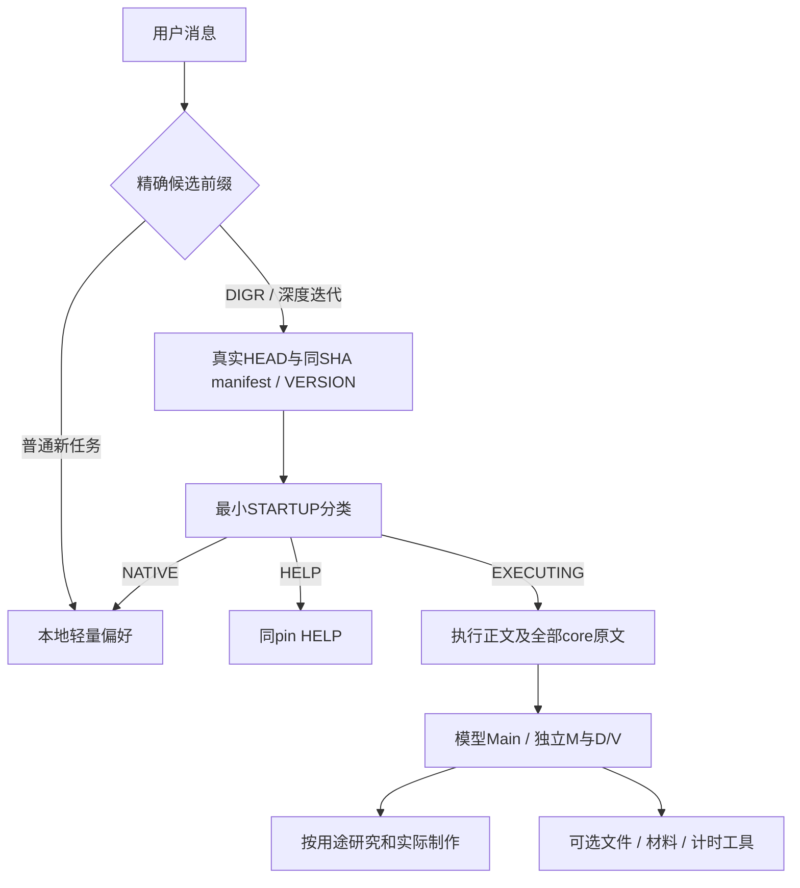

# DIGR Codex 0.6.0：执行语义、真实工具与宿主接入

本实验分支的使用入口是[根README](../README.md)，执行权威是本轮真实取得的同SHA `codex/manifest.json` 与所声明原文。根stable继续保持5.0.0-alpha.5，Python项目基础版本也保留该身份；Codex是独立版本化的原生模型profile，不是将stable执行器换名为0.6。

## 这次改变的中心

研究者气质进入真正读取的主正文与普通偏好：兴趣指向具体材料、现象与作品，敢形成偏爱，也让陌生材料改变什么值得追。D先自主侦察再形成强替代；V先研究形成分域，持续发展自己的材料、问题与作品；Main主动做强候选，必要时更换整体路线和具体生产主导。M新增为完整独立主进度数量，默认1，每线完整履行自己的责任。

这不是把所有任务改成更大管理系统。工作工具只补足实际传输、取材、接续和计时；经验保存自愿按需使用，不自动生成稳定偏好或给模型权重训练背书。分线包与只读汇总代替常驻行政计时管理员，实际作者、必要交流和最终综合仍由模型承担。

## 实际加载路径

本地路由不解析参数或复制执行语义。已有真实GitHub connector可直接取分支HEAD；直接REST使用同轮ref/branch一致SHA。每条精确前缀新消息都真实获取；同一任务已有P_run冻结。CLI的continue-from仅用于同次获取阶段接续，不是新调用的在线路由。

执行原文逻辑分文件维护，传输可聚合：

| 文件 | 职责 |
| --- | --- |
| codex/STARTUP.md | pin后分类、宿主事件、执行版本持续和停止 |
| codex/PROTOCOL.md | 问题、研究、创造、实际制作及收敛的主线 |
| codex/CHARACTER.md | 正向气质、材料如何改变眼光和有内容的范例 |
| codex/PARAMETERS.md | 单位责任、M、时间、调用和公开过程格式 |
| codex/COLLABORATION.md | Main竞争、D侦察/成熟介入、V分域续研、独立多Main |
| codex/PERMISSIONS.md | 持续任务授权、真实能力、费用与停止 |
| codex/EXECUTION_PROTOCOL.json | 上述执行正文和全部core的完整UTF-8原文与成员散列，不是摘要 |
| codex/WORKBENCH.md | 按需操作手册；不占每次最小启动切片 |

## 代码按能力分工

| 模块 | 实际提供的能力 |
| --- | --- |
| runtime/codex_profile.py | 离线分发检查/明确重建、宿主事件预览、轻量指令导出；不启动任务 |
| runtime/codex_transport.py | 实验通道真实ref解析、同pin分阶段读取、聚合原文校验与接续导出 |
| runtime/codex_workbench.py | 原始目标、自由标题纠正、研究节和显式材料选择；D/V可从无预设问题开始 |
| runtime/codex_experience.py | 可选保存当时选中的原片段，取回时提示原位置变化；不自动推断适用性 |
| runtime/codex_session.py | 每线完整参数、候选、笔记和未处理事项；真实活动边界、缺口及同域并集 |
| runtime/codex_permissions.py | 根据明确供给的任务授权和能力给建议，区分继续、查能力和预算等 |
| tools/codex.py | 统一CLI；原三个CLI兼容保留，不要求先装插件或启动服务 |

复用根模块中的路径、HTTPS、聚合原文验证等通用机制，不复用stable的参数解析、默认硬时间、Run Genesis或canonical最终闸门。脚本不会给N/R/D/V思想打分，不认证完整M已执行，也不冒称可更改宿主权限。

## M怎样在当前宿主成立

各M独立拿到原始目标、已确认要求、同一P_run及必要共同事实，再各自配置、研究制作与收敛。4槽可以先后/分批履行，不把一份N/R/D/V总额平分。root会收到代理返回；从头独立多线时宜由root做公共综合、独立上下文发展初稿；已有真实候选再扩线时root可兼原Main。交流后的修订承认影响，不能假称初期互未见答案。

每线普通文件与现有原生消息承载工作；注册几个包不等于实际M。共同用户纠正及时转交，恢复先看真实产物与最新要求；旧本线计划保持作者记录身份。可选经验也不能把某次气质纠正误学成所有工程都不做，或把论文例子误学成永不查论文。

## 时钟和授权的实际边界

Windows显式存活进程PID+创建时间可建立跨短命CLI时钟域；Linux取boot_id。真实单调读数与操作者在明确边界声明连续活动分别记录。恢复丢弃开放尾段，COMMON仅入全局，同域取并集，多域不盲加；无计时能力仍可继续制作。时钟域不证明模型持续工作。

授权来自真实用户目标与已有决定，能力来自宿主实际状态，执行与效果另看事实。普通任务内必要动作延续授权，原生分工按既有范围自主进行；新付款、代发消息、不可恢复大删除需相应授权。权限工具可不用，既不每次审批也不改OS沙箱。当前余额和限制须真实核对，不把旧API金额当新预算。

## 从0.5.1迁移

- 实验ref不变，本地薄路由不复制新参数。下次前缀调用取得新HEAD才使用新语义；进行中的0.5.1保持原P_run。
- 普通轻量文件新增正向气质，需合并到实际读取的AGENTS轻量块；路由和其它个人约定分别保留。导出CLI只打印，不假称安装。
- 完整执行从PROTOCOL+PARAMETERS改为PROTOCOL加四份core；manifest声明完整聚合包，减少传输往返，源文件仍独立可读。
- 旧workbench和profile命令兼容；新工具用统一入口。自由标题可显式选取，无需重整用户笔记或用户原件。
- 修改正文后运行profile refresh；发布器同时生成两套分发材料。私有.cache、Git入口与测试缓存不进入发布，也不为通过源码检查改写私有原件。

历史研究：[0.5.1适配说明](https://github.com/Gual-Wells/Deep-Iteration-GPT-Runtime/blob/11631eec1cbf3397a2b4d6d7cc24190188c0d2d6/docs/CODEX_ADAPTATION.md)、[M前期设计](MULTI_MAIN_PROPOSAL.md)、[气质与迁移研究](DV_AUTONOMY_UPDATE_PREPARATION.md)。本次取舍和实际落实见[升级工作笔记](research/codex-upgrade-20261108/WORK.md)。

已实现的工具、已发生的试作、实际发布和后续任务效果分别报告。协议优化没有改变基础模型权重或宿主采样参数；跨任务质量收益仍由实际使用观察。

## 本轮宿主原始资料对照

[官方AGENTS说明](https://learn.chatgpt.com/docs/agent-configuration/agents-md)确认全局与目录层级的合并/覆盖及大小上限；本机实际使用D:/CodexData/AGENTS.md，已经只同步普通轻量块并逐字节保留路由和其它个人约定。新AGENTS内容也实际进入了本轮宿主消息。执行正文继续按pin读取，不整套塞入全局指令。

[官方Subagents说明](https://learn.chatgpt.com/docs/agent-configuration/subagents)区分独立上下文、父级权限继承与共享编辑协调；[Responses Multi-agent说明](https://developers.openai.com/api/docs/guides/responses-multi-agent)描述本轮所用同类原生协调动作。它们支持采用原生能力，不能把不同产品的默认并发数当成本机配置。本轮工具实际为含root共4槽，fork_turns=none建立受控历史；协议中的槽位安排是条件化建议。

因此没有安装固定的全局D/V角色模板，也没有另外创建代理调度服务。动态分域与介入使用现有原生工具，明确编辑所有权并实际处理返回。文件或角色指令不能替代理改父级权限；本轮没有通过提示词宣称取消宿主限制。
